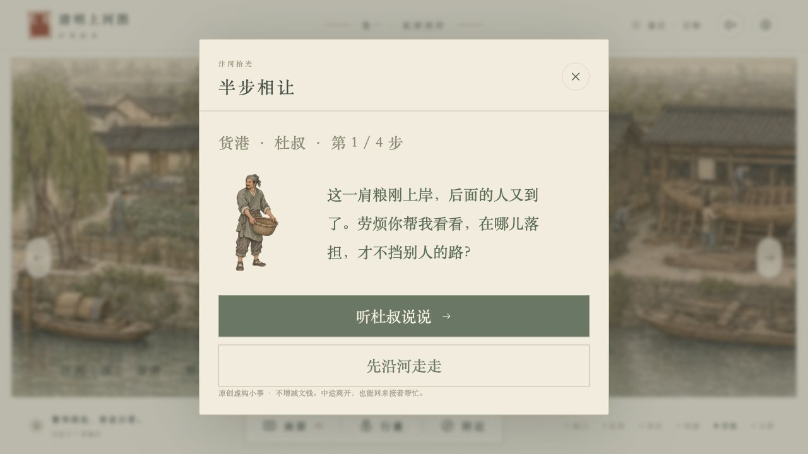
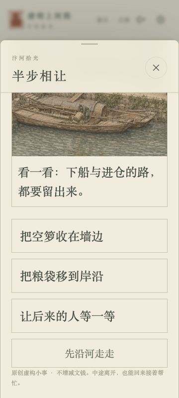

# 货港故事《半步相让》交付与验收

代码提交：`3aee30f9deaabc1b781d7f24bd87406a8990b959`，基线 `1a5c737370326408d634ea64317b71a9f1c8ef01`。PR [#133](https://github.com/lth2015/WonderLab/pull/133)。本报告的截图来自独立本地端口5179，不代表已部署上线。

## 交付

新增虚构脚夫杜叔与四步短故事：听他讲述→选择落担位置→收起空箩→记录画页。错误选项给出解释、不推进、不扣钱。完成获得第13页《半步相让》，不增加文钱，重逢不重复记页。透明立绘只显示在对话中，未把新人物叠到背景中；长卷中的场景仍为静态画面，并未实现挪箩动画。

新增画页已接入画册、留念PNG、师父评价及行程小结。保留原存档键，v0/v1迁到v2，仅补入货港未开始状态。生产只增加286256字节WebP；原PNG、提示词和清单留在美术分支 `docs/painted-worlds/art/china-harbor-v1/`。

## 验证结果

- 中国篇40项测试通过，包含6项新增状态/迁移/重复奖励/画页接入测试；TypeScript与Vite生产构建通过。
- 桌面实际点击货港的可见入口，四步通关；两类错误选择均只提示。第二步离开并刷新后仍从第二步继续。
- 实际下载并检查1440×1800《半步相让》PNG：图案、标题、文案正常，无图片缺失。
- 画册显示01/13，重逢再玩后仍1页；行囊仍60文。
- 360×800窄屏，UI开启150%大字后，正文24px、选择按钮24px且高约68.4px；页面clientWidth与scrollWidth均360，无横向溢出，竖向滚动可达所有选项。主要按钮按原产品大字规则为20px、高58px。
- 附近面板显示货港、纸铺、船工3项，另保留折叠文字入口与长卷导览。

## Standards

独立只读复核 `1a5c737...3aee30f`：无实质发现，未发现仓库硬标准违例。旧档迁移保留进度，四步动作有前置检查；重逢保留完成账本和画页；原生模态框、文字按钮与`role=status`提示未发现新增可访问性阻断。复核者没有另行执行测试；上述测试由实现方实际运行。

## Spec

独立只读复核：无发现。按Claude分工的“货港或城门选一处”“3～5步，有一页画册，不加新货币”“透明人物由你出”“扩到13页以上”，实现为货港4步、独立透明人物、第13页。不改变原卷坐标，不新增消耗或失败惩罚。

Standards 0项；Spec 0项。

## Claude接入顺序

先合最新main，保留同日Edo声音与美术接入；运行中国篇测试和生产构建，再做`/qingming/`子路径资源/旧档/新增故事验收，由Claude统筹部署。原生细节试样没有通过构图配准，不在本PR生产资产中。声音考据与PR127审查独立交付，不混入中国故事代码。
